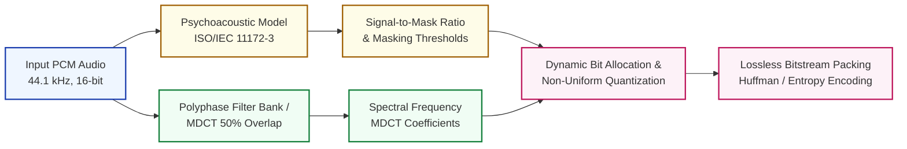

# Advanced Audio Coding & Psychoacoustic DSP Seminars

<div align="center">

[](https://www.python.org/)
[]()
[](https://www.tu-ilmenau.de/)
[](LICENSE)

**Technische Universität Ilmenau • Department of Electrical Engineering & Information Technology**  
*Graduate Course: Advanced Audio Coding (AAC / MP3 Signal Processing Architecture)*

</div>

---

## 📌 Overview

This repository contains the algorithmic implementations, mathematical derivations, and DSP pipelines developed across the four graduate seminars of the **Advanced Audio Coding** curriculum at TU Ilmenau (the historic birthplace of MP3 audio coding).

The work implements the end-to-end perceptual audio codec architecture: from time-frequency filter banks and Modified Discrete Cosine Transform (MDCT) to psychoacoustic masking models, non-uniform quantization, and bit allocation.

---

## 🎧 Perceptual Audio Codec Pipeline



---

## 📚 Seminar Curriculum Breakdown

### 🔬 Seminar 1: Quantization & Companding
- **Uniform vs. Non-Uniform Quantizers**: Implementation of mid-tread and mid-riser uniform quantizers.
- **Companding Laws ($\mu$-law / A-law)**: Logarithmic compression of high-dynamic range signals for telecommunications.
- **Signal-to-Quantization-Noise Ratio (SQNR)**: Empirical SQNR validation against theoretical limits ($6.02B + 1.76$ dB).

### 📡 Seminar 2: Sampling & Signal Reconstruction
- **Nyquist-Shannon Theorem**: Critical sampling, spectrum replication, and anti-aliasing filter design.
- **Interpolation & Decimation**: Multirate signal processing, polyphase decomposition, and spectral foldover elimination.

### 🎛️ Seminar 3: Filter Banks & Subband Coding
- **Quadrature Mirror Filters (QMF)**: Polyphase analysis and synthesis filter bank pairs.
- **Alias Cancellation**: Achieving Perfect Reconstruction (PR) under orthogonal and pseudo-QMF constraints.
- Code: [`Main.py`](audio-coding-seminars-master/Seminar%203/Main.py), [`functions.py`](audio-coding-seminars-master/Seminar%203/functions.py).

### 🎼 Seminar 4: MDCT & Psychoacoustic Masking
- **Modified Discrete Cosine Transform (MDCT)**: Overlapped block transform with 50% overlap.
- **Time-Domain Aliasing Cancellation (TDAC)**: Sine window and Kaiser-Bessel Derived (KBD) windows for critical subsampling.
- **Auditory Masking**: Simultaneous masking (tone-masking-noise and noise-masking-tone) and temporal masking.
- Code: [`MDCT.py`](audio-coding-seminars-master/Seminar%204%20/MDCT.py).

---

## 🚀 Getting Started

### Prerequisites
```bash
python -m venv venv
source venv/bin/activate  # On Windows: venv\Scriptsctivate
pip install numpy scipy matplotlib
```

### Running Seminar 3 (Filter Banks):
```bash
cd "audio-coding-seminars-master/Seminar 3"
python Main.py
```

### Running Seminar 4 (MDCT & TDAC Analysis):
```bash
cd "audio-coding-seminars-master/Seminar 4 "
python MDCT.py
```

---

## 📬 Contact

- **Author**: Sayan Bhattacharya
- **Email**: [sayanpm17@gmail.com](mailto:sayanpm17@gmail.com)
- **LinkedIn**: [linkedin.com/in/snbhattacharya5](https://www.linkedin.com/in/snbhattacharya5/)
